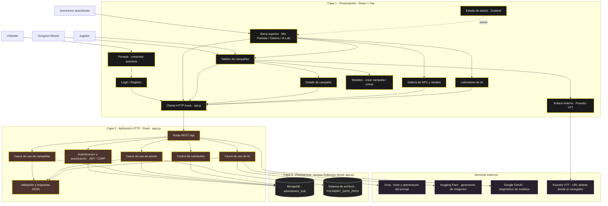
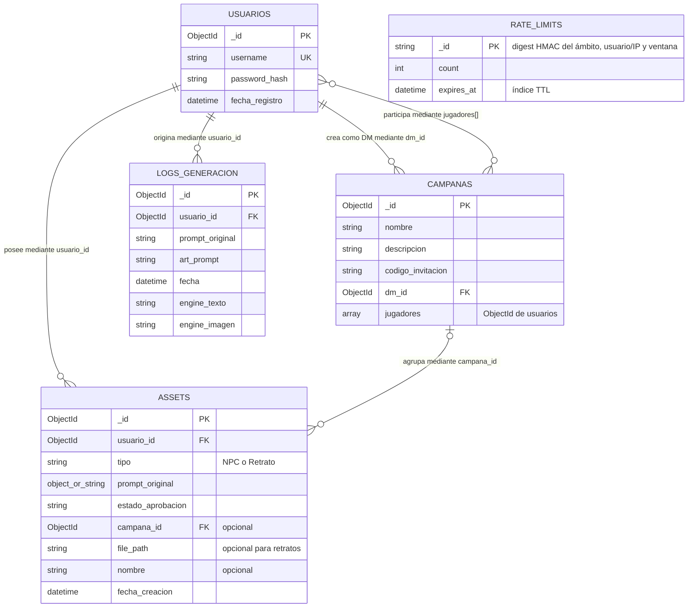
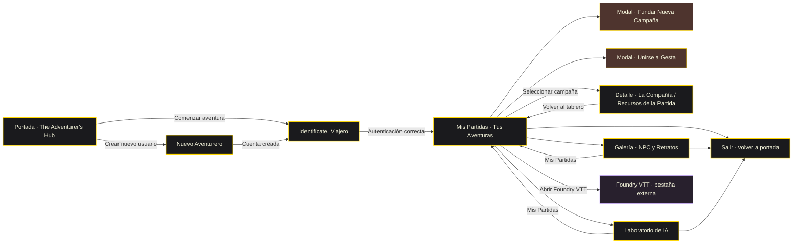
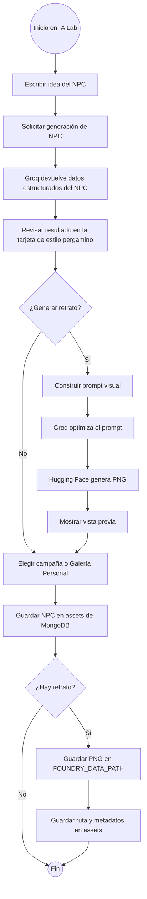

# Diagramas del sistema The Adventurers Hub

Los diagramas reflejan el código y las pantallas actuales del proyecto. La arquitectura se representa por capas lógicas y se indica dónde el código todavía concentra responsabilidades.

## Diseño visual

Se conserva la identidad de la interfaz actual: fondo oscuro `#1a1a1d`, madera `#4e342e`, dorado `#ffd700` y texto papel `#f5f5dc`. El usuario visitante llega a una portada temática; después de autenticarse, usa la navegación superior con **Mis Partidas**, **Galería**, **IA Lab** y **Salir**. Los diagramas usan los mismos nombres visibles y agrupan las pantallas según el flujo actual de React.

## 1. Arquitectura en n capas



**Lectura de capas:** la presentación React consume la API Flask. En el estado actual, `app.py` reúne rutas, autorización, reglas del negocio y operaciones PyMongo; por eso la capa de aplicación no se dibuja como servicios o repositorios separados. MongoDB conserva los documentos; los PNG se guardan en el sistema de archivos y MongoDB guarda su ruta. Foundry VTT se abre como enlace externo desde la interfaz, no como una llamada del backend.

## 2. Modelo de datos MongoDB existente



Las referencias se implementan como `ObjectId`; MongoDB no impone las claves foráneas del dibujo. `jugadores` es un arreglo embebido en cada campaña. Los NPC guardan su contenido en `prompt_original` como objeto o texto. Los retratos guardan `file_path` en MongoDB y el archivo PNG fuera de la base de datos. `rate_limits` es una colección técnica y no tiene relación directa con una cuenta: el identificador se calcula con HMAC.

## 3. Navegación de la interfaz actual



El estilo previsto para las pantallas y los diagramas reutiliza los tokens de `frontend/src/index.css`: fondo grafito, bordes y acciones en madera, acentos dorados y texto claro. El panel del NPC generado en IA usa además el color papel `#f4ece1`, coherente con la tarjeta actual.

## 4. Proceso principal · crear o unirse a una campaña

```mermaid
flowchart TD
  start((Inicio)) --> auth{¿Tiene sesión?}
  auth -->|No| signin[Ingresar o registrarse]
  signin --> auth
  auth -->|Sí| board[Consultar Mis Partidas]
  board --> choice{Acción}
  choice -->|Crear| form[Completar nombre y descripción]
  form --> validate[Validar datos y sesión]
  validate --> save1[(Crear documento en campanas)]
  save1 --> invite[Generar código de invitación]
  invite --> refresh[Actualizar tablero]
  choice -->|Unirse| code[Ingresar código]
  code --> find[Buscar campaña por código]
  find --> member{¿Código válido y no pertenece?}
  member -->|No| error[Mostrar error]
  error --> code
  member -->|Sí| add[Agregar usuario a jugadores[]]
  add --> refresh
  refresh --> finish((Fin))
```

## 5. Proceso principal · generar y guardar un NPC con retrato



## Observaciones sobre el alcance actual

- Los perfiles **Dungeon Master** y **Jugador** son roles relativos a cada campaña (`dm_id` y `jugadores[]`), no roles globales guardados en `usuarios`.
- La interfaz actual limita el campo del código de invitación a 6 caracteres; el backend acepta de 6 a 8 y crea códigos de 8. Conviene alinear ese campo para que el flujo de unirse funcione con los códigos generados.
- La Galería muestra el control de borrar, pero el componente actual solo quita el elemento del estado local; no ejecuta la eliminación persistente aunque exista una ruta DELETE en el backend.

